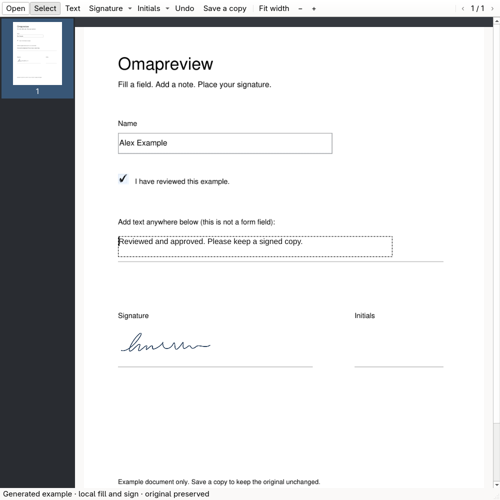

# Omapreview

A small, local PDF fill-and-sign app for Omarchy. No account, uploads, cloud service, tool palette, or PDF authoring suite.

The preview uses a generated document and fictional sample ink, not a real person's PDF or signature.

## Use

Launch `omapreview` from your application launcher, the Omarchy bar button, or a terminal:

    omapreview /path/to/document.pdf

- Fill existing PDF form fields directly on the page. Click a checkbox to toggle it; click another radio option to switch, or the selected option again to clear the group. Select all text and press Backspace to leave a native text field truly empty—no placeholder space needed.
- Choose Text, then drag a box where the words should wrap. A click creates a default-size box.
- Select a text box or click inside a PDF text field to show the Text size row below the main toolbar. It also appears while the Text tool is active, so you can choose the size before drawing the next box. It hides outside those text contexts. Annotation sizes are preserved through save/reopen and Undo.
- Auto-sized PDF fields use a fitted default capped at 12 points instead of growing to the field's full height. The typing editor follows that fitted size. An explicit Size adjustment is saved as chosen; very large manual sizes can clip inside a fixed PDF field, so reduce the size if needed.
- Select any added text or signature again by clicking it. Drag its body to move it; drag the visible bottom-right handle to resize it. Text rewraps; signatures keep their proportions.
- Double-click a text box to edit its words. Click outside it to return to moving/selecting.
- Click Signature or Initials to use your primary saved mark. Draw or import one the first time.
- Open the arrow beside Signature or Initials for:
  - Sign once… — someone can sign this document without adding their mark to the reusable library.
  - Add saved signature… / Add saved initials… — save an additional mark without replacing the primary. A name is optional; blank names become Signature 2, Signature 3, etc. (or Initials 2, Initials 3).
  - Saved signatures… / Saved initials… — choose by name and preview, or forget an individual mark.
  - Replace saved / Forget saved — replace or forget the primary mark.
- New drawings use smoothed curves and high-resolution ink. Placed images use smooth scaling, and saved PDFs request image interpolation for cleaner edges. Old low-resolution imported images still have their original resolution limits.
- Save a copy. New marks stay editable after changing pages, saving, and reopening in Omapreview.
- Scroll normally through the continuous document. Click a page thumbnail in the left rail to jump there; the highlighted thumbnail and far-right previous / page count / next controls follow your current page. Edits remain editable when you return to a page.
- The PDF preview automatically renders for your window size, zoom and display pixel density. Fit width follows window resizing; explicit zoom is retained. Full-page preview allocation is bounded at extreme zoom, and low-resolution scans still have their original detail limits.
- Delete removes a selected mark; Undo reverses edits.

Existing page text and marks flattened by earlier Omapreview versions are not selectable objects. Newly added marks carry private, versioned editing metadata inside the PDF (no sidecar); other PDF readers display the normal page content. Third-party optimizers that discard that metadata can remove Omapreview editability. Moving/deleting a mark is not secure redaction.

The source PDF is never overwritten. Save a copy writes a PDF that can be opened by other readers, with real form values and your placed text/images. Saved signatures are visual handwritten marks, not certificate-based digital signatures. Modifying an already digitally signed PDF can invalidate its cryptographic signature; use an unsigned copy.

## Install

Omapreview has two parts: a native desktop application and a small Omarchy bar launcher (`coak.omapreview`). The marketplace installs the bar launcher, not the Python application runtime. Complete the one-time application setup before enabling the plugin.

The locked installer supports Omarchy Quattro on Linux x86_64 with system CPython 3.14 and glibc 2.39 or newer. Git and uv are trusted host prerequisites; install uv explicitly with `omarchy pkg add uv` if needed. Setup does not download an interpreter or silently resolve dependencies for other platforms. Unsupported systems fail closed rather than selecting a different package graph.

Use this exact runtime revision. Do not replace it with `main`, a branch, or a movable tag:

    RUNTIME_REVISION=84c9edf111f710d9ec6615ee6ca60cbcf315936e
    APP_ROOT="${XDG_DATA_HOME:-$HOME/.local/share}/omapreview/app"
    git clone --no-checkout https://github.com/Cause-of-a-Kind/omapreview.git "$APP_ROOT"
    git -C "$APP_ROOT" checkout --detach "$RUNTIME_REVISION"
    cd "$APP_ROOT"
    ./bin/setup --revision "$RUNTIME_REVISION"
    ./bin/install --desktop-only
    omarchy plugin add https://github.com/Cause-of-a-Kind/omapreview.git --enable

If the marketplace already installed the bar plugin, complete the runtime commands through `bin/install --desktop-only` and skip the final `omarchy plugin add` command. The bar button, application launcher and PDF Open With entry use that installed application. The default PDF viewer is unchanged.

Keep the application checkout outside `~/.config/omarchy/plugins/`: Omarchy forbids symlinks in plugin payloads, and Python virtual environments contain symlinks. The plugin checkout must remain runtime-free. No dependency download, build, or installation runs when the bar button is clicked.

### Reproducible setup boundary

- `bin/setup --revision` requires the complete 40-character source SHA, matching HEAD, a clean checkout and ordinary Git index flags before invoking uv. It builds from that commit's archived bytes, not ignored or generated checkout files.
- `requirements-runtime.txt` locks the complete qualified runtime dependency graph to exact versions and SHA-256 distribution hashes. `requirements-build.txt` separately pins and hashes setuptools and the uv build frontend. Their `.in` files record the selected inputs; each generated lock records its compile command.
- External packages are installed as hash-verified wheels with dependency resolution disabled. The application wheel is built offline with the already verified frontend/backend, without build isolation or additional build downloads, then installed offline and non-editably with `--no-deps`.
- The launcher runs installed site-packages with Python `-I`; it does not load application code from the checkout, current directory or `PYTHONPATH`. Dependency setup needs network access, but filling/signing documents does not.
- Setup refuses an existing `.venv`. On failure it removes only the runtime created by that invocation. Use a fresh checkout for a new revision rather than updating a populated environment in place. There is no automatic runtime update.

The full runtime commit is recorded above in a later documentation-only commit because a commit cannot contain its own SHA. The runtime code, dependency locks, build configuration and launcher are identical between the pinned runtime commit and this listing's documentation commit. Each new runtime revision needs qualification and a new marketplace review; a source push is not marketplace approval. The OS, Git, host Python, initial uv bootstrap, package index and the user's account remain trust boundaries; this is not protection against a compromised host or a security-audit claim.

### Existing installations

The pre-0.1.1 editable setup is not converted automatically. Save your work and close the app before changing installations. For an upgrade, choose a new application checkout directory, verify and remove only the three old installer-created launcher/desktop/icon symlinks listed under Uninstall, then follow the pinned runtime setup and desktop installation above. Leave an already installed bar plugin in place. Keep the old checkout until the replacement works. Never delete the saved-signature directory or PDFs as part of an upgrade.

## Local development

The production setup intentionally rejects dirty source. In a clean committed development checkout, install the same locked runtime plus the separate test-tool lock explicitly:

    ./bin/setup --revision "$(git rev-parse HEAD)" --dev
    ./bin/install --desktop-only

`requirements-dev.txt` is installed only with `--dev`; ordinary users do not receive pytest or other test-only tools. `bin/test` intentionally tests checkout source, while the desktop launcher always uses the installed wheel. Rebuild in a fresh checkout/environment when testing a different installed runtime.

The desktop installer registers the application/PDF Open With entry without changing the Omarchy bar when passed `--desktop-only`. Without that flag it also validates/copies the small shell plugin payload, rescans plugins and enables `coak.omapreview`. It refuses unrelated existing launchers or plugin directories and never changes your default PDF viewer, keybindings, or system packages. Keep the application checkout at its installed location because the desktop links point to its launcher and assets.

## Uninstall

Close Omapreview after saving your work, then remove its bar plugin:

    omarchy plugin remove coak.omapreview

The application installer creates these three symlinks. Check that each points into your Omapreview application checkout, then remove those links (not their targets):

- `~/.local/bin/omapreview`
- `${XDG_DATA_HOME:-~/.local/share}/applications/coak.omapreview.desktop`
- `${XDG_DATA_HOME:-~/.local/share}/icons/hicolor/scalable/apps/coak.omapreview.svg`

Run `update-desktop-database "${XDG_DATA_HOME:-$HOME/.local/share}/applications"` if available. You can then remove the application checkout and its `.venv`. Uninstall does not remove PDFs or the saved-signature library described below. Do not delete the entire `omapreview` data directory if you want to keep saved signatures.

## Local data

Signature and initials images are stored under:

    ${XDG_DATA_HOME:-~/.local/share}/omapreview/signatures/

They are private local files, not encrypted storage. Anyone with access to your Linux account or its backups may be able to retrieve them. They are not committed to this repository. Use the mark controls to replace or delete saved marks. Sign once does not create a library entry or overwrite any saved mark; its ink is included in the PDF when you save that document, as expected. It is not a promise of secure memory erasure or forensic deletion.

## Development

    ./bin/test

The Qt tests run offscreen. All PDF fixtures use generated data. To make an example PDF:

    .venv/bin/python tools/make_example.py /path/to/example.pdf

Implementation: Python, native Qt Widgets (PySide6), and MuPDF (PyMuPDF). The application has no network feature. Dependency installation uses the network; PDF processing does not.

## Scope

This is a focused fill-and-sign application, not a complete macOS Preview clone. No OCR, page rearrangement, drawing toolkit, redaction, certificate signing, or XFA form support is promised. A scan can receive text/signature overlays without OCR. Unsupported fields can be filled visually with Text instead. Large PDFs and unusual vendor-specific form appearances should be checked in another reader before sending.

## License

AGPL-3.0-or-later; see LICENSE. PyMuPDF uses the AGPL/commercial dual-license model. This project uses the AGPL option; retain the corresponding source and license obligations when distributing it.
